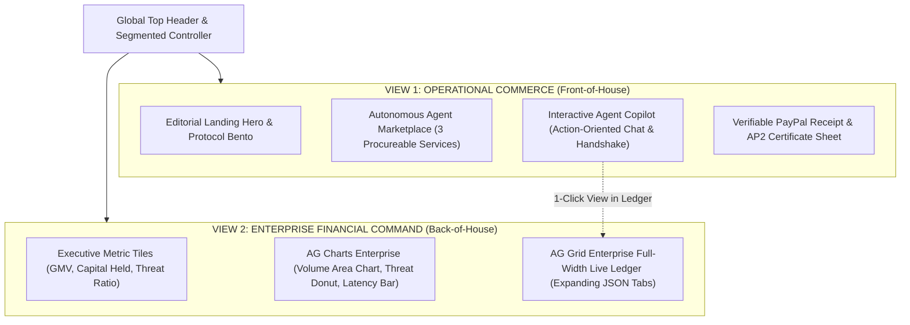

# Product Design Requirements Document (Design PRD)

## Project Title: pyFides — The Fiduciary Settlement Protocol for the Autonomous Agent Economy
**Document Type:** Brand Identity, Design System & Product Experience Specification (UI/UX PRD)  
**Target Designer:** Senior Brand / Lead Product Designer  
**Target Aesthetic Benchmark:** Apple Design System (Emil Kowalski WWDC principles), Stripe Press, Linear, SpaciaOS, and Apple Wallet / Pay  
**Document Version:** 2.0.0 (High-Grade Overhaul)  
**Author:** Lead FinTech Architect & Product Lead  

---

## 1. Design Vision, Archetype & Emotional Thesis

### 1.1 The High-Concept Elevator Pitch
> *"Imagine if Apple Wallet, Bloomberg Terminal, and Stripe were reimagined in 2026 as an autonomous fiduciary protocol for AI agents."*

As the global internet transitions from human-initiated checkouts to autonomous machine-to-machine (A2A) commerce, AI agents are purchasing compute, datasets, and microservices directly from other machines. 

**pyFides** is the zero-trust settlement and escrow layer backed by Google's open **Agent Payments Protocol (AP2)**, **PayPal Orders v2**, and **PYUSD stablecoins**.

### 1.2 The Emotional Archetype: "The Digital Fiduciary"
* **Not a Hacker Terminal:** Strictly reject glowing green terminal text, pitch-black cyberpunk clichés, generic chatbot bubbles, and noisy neon borders.
* **The Tone:** **Savile Row meets Silicon Valley.** Calm, authoritative, mathematical, tactile, and uncompromisingly lucid. It must look like high-priced enterprise software built by a world-class studio.
* **Core Emotional Objective:** The user and judges must feel an immediate sense of **absolute financial safety, cryptographic finality, and physical tactile joy**.

---

## 2. Visual Tokens & Design System Foundation

The designer must construct a cohesive, tokenized design system in Figma.

### 2.1 Color Palette & Semantic Tones

```
Canvas & Surfaces:
├── Warm Stone Canvas:     #FAFAF9  (Light Mode Foundation)
├── Pure Elevated White:   #FFFFFF  (Card & Floating Container Surface)
├── Subtle Stone Border:   #E7E5E4  (1px hairline separation, stone-200)
├── Obsidian Dark Surface: #0C0A09  (High-Contrast Elements / Dark Toggle)
└── Muted Slate Surface:   #F5F5F4  (Subtle secondary wells, stone-100)

Brand & Protocol Anchors:
├── PayPal Royal Navy:     #001C64  (Deep editorial anchor, primary brand text)
├── PayPal Electric Blue:  #0070BA  (Interactive buttons, active indicators)
└── Protocol Cyan:         #0284C7  (AP2 technical badges, sky-600)

Cryptographic & Financial Status Signals (Soft Pastels, Never Harsh Neon):
├── Settled / Verified:    #059669  (Emerald-600) | Soft Tint: #ECFDF5 (Emerald-50)
├── Escrow Pending Hold:   #D97706  (Amber-600)   | Soft Tint: #FFFBEB (Amber-50)
├── Quarantined / Threat:  #DC2626  (Rose-600)    | Soft Tint: #FEF2F2 (Rose-50)
└── Voided / Refunded:     #64748B  (Slate-500)   | Soft Tint: #F8FAFC (Slate-50)
```

### 2.2 Typography Hierarchy & Optical Sizing

| Role | Font Family | Weight | Tracking (Letter Spacing) | Usage Example |
| :--- | :--- | :--- | :--- | :--- |
| **Display Editorial** | *Instrument Serif* / *Newsreader* | Regular & Italic | `-0.035em` (Tight) | Main landing headlines: *"The Fiduciary Settlement Protocol."* |
| **Primary Interface** | *SF Pro Display* / *Inter* | Medium (500) & SemiBold (600) | `-0.02em` | Section headers, card titles, button labels |
| **Body & Labels** | *SF Pro Text* / *Inter* | Regular (400) | `-0.01em` | Descriptions, explanatory captions, metadata |
| **Financial & Cryptographic** | *JetBrains Mono* / *SF Mono* | Medium (500) | `0em` (`tabular-nums`) | Monetary sums (`$28.00`), Hashes (`sha256_...`), Signatures, IDs |

> [!IMPORTANT]
> **Strict Typography Rule:** Monospace typography must **only** be used for hashes, signatures, code blocks, and tabular financial values. Never render standard prose, descriptions, or titles in monospace.

### 2.3 Surface Materials, Depth & Hairline Borders
* **Frosted Translucent Glass:** Navigation bars, action docks, and floating drawers must use `backdrop-filter: blur(24px)` with `background: rgba(255, 255, 255, 0.75)` (or `rgba(12, 10, 9, 0.75)` in dark mode).
* **Apple Hairline Inner Highlights:** Cards must feature a subtle inner top highlight to mimic physical glass bevels:  
  `box-shadow: inset 0 1px 0 rgba(255, 255, 255, 0.6), 0 4px 20px -2px rgba(0, 0, 0, 0.04);`
* **Zero Secret Leakage:** Never render internal sandbox keys, developer tokens, or BN partner codes (`FLAVORsb...`) on public headers or client-facing views.

---

## 3. Information Architecture: The Dual-Console Paradigm

To eliminate visual clutter, the interface is split into **Two Dedicated Experiences** connected by an Apple-style floating segmented controller at the top:

```
┌────────────────────────────────────────────────────────────────────────────────────────┐
│  pyFides   [  🛍️ Autonomous Marketplace & Copilot  |  📊 Treasury & Risk Ledger (AG Studio)  ]  │
└────────────────────────────────────────────────────────────────────────────────────────┘
```



---

## 4. Detailed Screen-by-Screen Specifications

### Screen 1: The High-Prestige Editorial Landing Page

#### Purpose
Establish immediate institutional credibility, clearly articulate the A2A payment problem, and guide users into the live interactive console.

#### Key Modules
1. **Hero Header:**
   * Poetic Display Serif Headline: *"The Fiduciary Settlement Protocol for the Autonomous Machine Economy."*
   * Subhead explaining that when AI agents buy compute and data, pyFides provides cryptographic zero-trust escrow on PayPal Orders v2 and PYUSD stablecoin rails.
   * Primary Action: High-tactile pill CTA: *"Launch Fiduciary Console ➔"*.
2. **The 3-Card Architectural Bento Grid:**
   * **Card 1: Bounded Intent Mandates:** Visualizing how human principals sign mathematical spend caps ($30.00 max) to prevent agent wallet draining.
   * **Card 2: Two-Phase PayPal Escrow:** Visualizing the Orders v2 `AUTHORIZE` hold and `CAPTURE` conditional trigger.
   * **Card 3: Cryptographic Delivery Oracle:** Visualizing the SHA-256 hash digest verification of computed assets before release.
3. **Protocol Comparison Matrix:**
   * Clean, beautifully formatted table comparing **Google AP2 (pyFides)** vs. **Stripe ACP** vs. **Coinbase x402** across Trust Model, Spend Caps, Dispute Resolution, and Open Consortium Backing.

---

### Screen 2: View 1 — The Autonomous Agent Marketplace & Interactive Copilot

#### Purpose
A real-world e-commerce environment where an operator or autonomous agent procures real digital assets with zero mock simulation buttons.

#### Layout Structure (Split-Pane / Asymmetric Grid)
* **Left Stage (60% Width): The Agent Marketplace**
  * Displays 3 enterprise AI services:
    1. **NVIDIA H100 GPU Inference Burst (100 Compute Units)** — `$28.00 USD`
    2. **Q4 Financial Sentiment Intelligence Vector Dataset (10k rows)** — `$25.00 USD / PYUSD`
    3. **Real-Time FinTech AP2 Gateway Micro-Subscription** — `$15.00 USD`
  * Each card features: Service title, provider agent ID, SLA specs, pricing badge, and a high-tactile button: **"Procure via Agent Escrow"**.
* **Right Stage (40% Width): The Action-Oriented Agent Copilot**
  * **Not a plain text chat!** It is an **interactive handshake thread** where every stage of the transaction renders an Apple Wallet / Linear-style interactive card:
    * **Step 1 Card (Intent Mandate):** Shows spend cap ($30.00 max), principal user signature, and Ed25519 verification pill.
    * **Step 2 Card (A2A Dialogue):** Compact, elegant conversation between Buyer Agent Alpha and Seller Agent Beta negotiating price and SLA specs via APIMatic schema.
    * **Step 3 Card (PayPal Escrow Hold):** Live PayPal Sandbox Authorization card showing `Status: PENDING_AUTHORIZE`, PayPal Order ID, and amount locked.
    * **Step 4 Card (Deliverable Verification):** Oracle badge showing live mathematical SHA-256 hash match (`Expected: 8f43...` == `Actual: 8f43...`).
    * **Step 5 Card (Settlement & Receipt):** Confirmed `CAPTURE` on PayPal rails with 1-click **"View AP2 Certificate"** and **"View in Treasury Ledger ➔"**.
  * **Natural Language Input Dock:** Floating bottom pill input with pre-filled suggestions:
    * *"Procure Q4 Sentiment Dataset under $30"*
    * *"Negotiate 10% discount on GPU compute"*
    * *"Test adversarial prompt injection against seller"*

---

### Screen 3: View 2 — Enterprise Treasury, Risk Analytics (AG Charts) & Settlement Ledger (AG Grid)

#### Purpose
The executive command center for CFOs and Risk Officers. Full-width, sophisticated data visualization and auditable ledger with zero clutter.

#### Key Modules
1. **Top Executive Metric Cards (4-Column Bento):**
   * **Total Volume Settled:** e.g., `$12,450.00` (`+18.4%` this week) with USD / PYUSD breakdown.
   * **Active Capital in Escrow:** e.g., `$1,820.00` (Protected across 14 pending machine deliveries).
   * **Threats Quarantined (OWASP MCP Top 10):** e.g., `42 Injections Blocked` (`$0.00` loss).
   * **Oracle Settlement Accuracy:** `100.0%` (Zero deliverable mismatch losses).
2. **AG Charts Enterprise Visualizations (2-Column Grid):**
   * **Chart A: Cumulative Settlement Flow (Area / Line Chart):** Dual-color curve showing fiat PayPal Orders volume vs. PYUSD stablecoin volume over time.
   * **Chart B: Threat & Resolution Distribution (Donut Chart):** Visualizing *Successfully Settled* vs. *Prompt Injections Quarantined* vs. *SLA Timeout Auto-Refunds*.
   * **Chart C: Escrow Turnaround Velocity (Bar Chart):** Showing settlement latency (avg 140ms).
3. **AG Grid Enterprise Full-Width Live Ledger:**
   * Styled in AG Grid Quartz Theme customized with warm stone tokens.
   * **Columns:**
     1. `Transaction ID` (Monospace, e.g. `TX-MVYF4MX6`)
     2. `Escrow State` (Custom pill renderer: `HELD_IN_ESCROW` [Amber], `SETTLED` [Emerald], `QUARANTINED` [Rose], `REFUNDED` [Slate])
     3. `Asset / SKU` (e.g. `H100-BURST-100U`)
     4. `Settlement Rails` (Badges for `PayPal Orders v2` or `PYUSD Stablecoin`)
     5. `Amount` (Tabular monospace, e.g. `$28.00 USD`)
     6. `Oracle Status` (SHA-256 verified checkmark)
     7. `Actions` (Buttons: *"Inspect Mandates"*, *"View Receipt"*)
   * **Master-Detail Row Expansion:** Clicking any row smoothly expands an inline drawer showing the raw canonical AP2 JSON Mandates (`Intent`, `Cart`, `Payment`) with copy buttons.

---

### Screen 4: The Verifiable AP2 Cryptographic Certificate (Sheet / Modal)

#### Purpose
Provide a mathematically verifiable, printable, and downloadable proof-of-settlement for machines and corporate accountants.

#### Visual Structure (Apple Pay / Airline Pass Caliber)
* **Header:** pyFides Seal + PayPal Complete Platform Escrow badge.
* **Hero Figure:** Large formatted amount (`$28.00 USD` or `28.00 PYUSD`) with glowing subtle emerald status ring: `CRYPTOGRAPHICALLY VERIFIED & SETTLED`.
* **Metadata Grid:**
  * `Authorization ID`: `AUTH-ORD-993821`
  * `Capture ID`: `CAP-993821-X`
  * `Principal Spend Cap`: `$30.00 USD (Authorized)`
  * `Deliverable SHA-256`: `8f434346648f6b96df89dda901c5176b...`
  * `Ed25519 Principal Signature`: `Verified ✓ (RFC 8785 Canonical)`
* **Actions:**
  * Button 1: *"Download Cryptographic JSON Mandate"*
  * Button 2: *"Print PDF Audit Certificate"*
  * Button 3: Close / Dismiss pill.

---

## 5. Micro-Interactions, Motion Design & Spring Physics

Following Emil Kowalski's Apple Design guidelines, motion must feel physically alive, continuous, and interruptible:

1. **Tactile Response (Kill Latency):**
   * All clickable cards and buttons must respond on pointer-down:
     ```css
     .action-button:active, .marketplace-card:active {
       transform: scale(0.98);
       transition: transform 80ms cubic-bezier(0.2, 0, 1);
     }
     ```
2. **Spring Physics for Transitions:**
   * Segmented control tab switches and sheet modals must use critically damped spring motion (`damping: 1.0`, `response: 0.35s`), with zero jarring layout snaps.
3. **Escrow Status Morphing:**
   * When an escrow transitions from `AUTHORIZE (Held)` to `CAPTURE (Settled)`, the amber pill does not abruptly blink into green; it smoothly cross-fades color and pulses once with a soft green radial glow.
4. **Adversarial Attack Reaction:**
   * When testing a prompt injection, the card shakes subtly with a damped horizontal impulse (`±4px`), accompanied by a soft crimson quarantine badge and explanation tooltip.

---

## 6. Comprehensive States Matrix (For the Designer)

The designer must provide Figma mockups for all component states:

| Component | Default State | Active / Hover | Progress / In-Flight | Verified / Success | Error / Quarantined |
| :--- | :--- | :--- | :--- | :--- | :--- |
| **Marketplace Card** | Clean stone card, elevated shadow-sm | Subtle 2px elevation, border darken | Button shows spinning indeterminate ring | Soft green border highlight | Dimmed with "Out of Stock / SLA Breached" |
| **Copilot Message Card** | Frosted glass card with hairline border | Hover reveals copy action | Typing / handshake pulsing dots | Green checkmark with cryptographic badge | Red border, alert badge: "Prompt Injection Defended" |
| **AG Grid Ledger Row** | Clean white/stone alternating rows | Soft blue highlight (`#F0F7FF`) | Pulse animation on row insertion | Static clean green pill | Red strikethrough or alert pill |
| **Segmented View Switcher** | Inactive tab has subtle slate text | Hover brightens text | Sliding glass indicator capsule | Locked to active view | N/A |

---

## 7. Figma Deliverables & Handoff Checklist

The brand and UI designer must deliver a Figma file containing:

- [ ] **Design Tokens & Styles:**
  - Color styles (Semantic, Accents, Backgrounds, Borders) for both Light and Dark mode.
  - Typography styles (Instrument Serif + Inter + JetBrains Mono) with responsive scale.
  - Elevation & Drop Shadows (Inner bevels, ambient ambient blurs).
- [ ] **Component Library (Auto-Layout 5.0 with Variants):**
  - Navigation Bar & Segmented View Switcher.
  - Marketplace Service Cards with pricing tiers.
  - Copilot Thread Cards (Intent Mandate, A2A Chat, PayPal Escrow Hold, Oracle Hash, Receipt).
  - AG Charts styled containers (Volume Area, Threat Donut, Latency Bar).
  - Custom AG Grid Cell Renderers (Status pills, rail badges, copy hashes).
  - AP2 Verifiable Settlement Sheet Modal.
- [ ] **High-Fidelity Screen Mockups (1440px Desktop & 390px Mobile):**
  - Screen 1: High-Prestige Editorial Landing Page.
  - Screen 2: View 1 — Marketplace & Interactive Copilot.
  - Screen 3: View 2 — Treasury Analytics (AG Charts) & Live Ledger (AG Grid).
  - Screen 4: Verifiable AP2 Certificate Modal.
- [ ] **Interactive Prototype:**
  - Clicking "Procure" opens the Copilot thread.
  - Step-by-step cards populate through to the PayPal receipt.
  - Segmented control switches seamlessly between Marketplace and Treasury.
